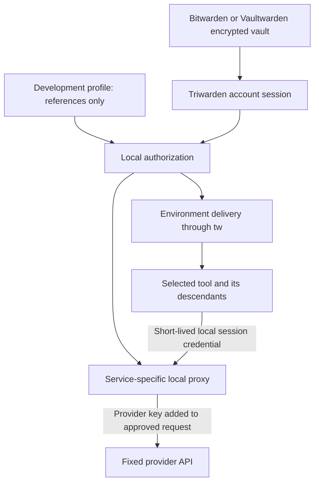

# Bitwarden-backed local Secrets Agent

Date: 2026-10-19
Status: Stage 1 core implemented. On 2026-10-21, the signed app passed native Keychain, real dev-account cancellation, and user-assisted device-owner authentication through successful CLI exec with a dummy key. The approval panel matches the app's form style. Settings UI passed on the active desktop; a later rerun could not enable XCTest automation.

## Purpose

Make API keys available to local development tools and AI agents without routinely copying them through the clipboard, pasting them into conversations, or keeping their values in `~/.zshrc` and project configuration files.

Bitwarden Password Manager is the source of truth. Triwarden supplies the native management interface, local authorization, and delivery to tools. This uses ordinary vault items and remains compatible with Bitwarden and Vaultwarden; it does not require Bitwarden Secrets Manager, machine accounts, or a second backend.

The user should configure a development environment once, launch a tool, approve the specific credentials it needs, and work normally.

## Goals and security boundary

- Store and sync credential values through the existing encrypted vault.
- Keep values out of launch configuration, command arguments, normal logs, shell startup files, and the default clipboard workflow.
- Grant access to selected fields, not the whole vault.
- Support ordinary tools through environment variables.
- Offer service-specific proxies where a tool supports a configurable API endpoint and the original provider key should remain inside Triwarden.
- Preserve normal terminal interaction, streaming responses, exit status, and cancellation.

Environment injection gives the receiving process and its descendants the plaintext values. Other processes running as the same macOS user may also inspect process arguments or environment data (for example through process inspection interfaces); this is not an isolation boundary between same-user processes. It cannot prevent an agent from printing, saving, or sending those values. Locking Triwarden cannot recall a value already delivered.

A proxy keeps the original provider key within Triwarden and the provider request, but its local session credential still authorizes API usage. A compromised authorized tool can abuse permitted operations. Neither mode creates a sandbox or protects against full compromise of the user's Mac.

SSH remains on the existing SSH agent path: it returns signatures without handing out private keys. API credentials have different protocols, so there is no universal SSH-agent equivalent for every API.

## Architecture



The vault remains responsible for storage, encryption, synchronization, and server-side sharing permissions. Development profiles and local grants add delivery controls on this Mac; they do not change Bitwarden permissions or restrict other clients that already have vault access.

## Credential representation

Provide an “API credential” editor as a Triwarden presentation of a standard Secure Note with custom fields. Do not introduce a server-side cipher type.

Recommended initial schema:

| Field | Storage |
| --- | --- |
| Display name | Standard item name |
| Credential value | Hidden custom field named `secret` |
| Provider | Text custom field with a Triwarden namespace |
| Suggested environment variable | Text custom field with a Triwarden namespace |
| Development/production label | Text custom field with a Triwarden namespace |
| Optional expiry date | Text custom field with a Triwarden namespace |
| Schema version | Text custom field with a Triwarden namespace |
| Notes | Standard notes field; no duplicate credential value |

Other Bitwarden clients can inspect and edit these standard items. A hidden field masks presentation; it is not a separate permission boundary. Validate compatibility with official clients before release.

Existing password and hidden custom fields can also be selected without converting their items. Automatic bindings use server/account identity, item UUID, and an explicit field selector, never fuzzy name matching. Custom fields do not provide a reliable cross-client field UUID: duplicate field names are rejected, and a renamed or missing field requires rebinding rather than guessing.

Deleted, archived, inaccessible, or ambiguous items cannot satisfy a binding. Existing item-level authentication requirements still apply.

## Development profiles

A profile defines a local workflow, for example `research-agent-dev`:

| Setting | Example |
| --- | --- |
| Working directory | A user-selected project directory |
| Launch target | An executable and argument array |
| Environment bindings | `ANTHROPIC_API_KEY` → one vault field |
| Additional bindings | `SEARCH_API_KEY` → another vault field |
| Delivery mode | Environment injection or an installed service adapter |
| Freshness policy | Online refresh required, or explicit cached access |

Profiles contain references and configuration, never resolved secret values. Store them locally in application support with restrictive permissions. Paths and authorization decisions remain local; profile synchronization is outside the first release.

Project files may describe requested variable names, but cannot silently install trusted bindings or change launch grants. Importing or changing a profile requires reviewing its resolved credentials and launch configuration. A project directory is context, not proof that its code is trustworthy.

Reject duplicate variable names, malformed names, unsupported values such as embedded NUL, and dangerous runtime-control bindings such as dynamic-loader variables. Do not silently overwrite an existing variable: show the collision and require an explicit profile decision.

## User experience

1. Add an API credential, or select an existing vault field.
2. Create a development profile and select only its required credentials.
3. Select a tool and working directory. Preview the variable names and delivery mode without revealing values.
4. Launch from the terminal, or use a saved launch action in Triwarden.
5. Review one authorization card for the complete launch, authenticate, and continue in the tool.

Proposed CLI syntax, not an existing feature:

```sh
tw run --profile research-agent-dev -- agent-command
tw run --profile web-dev -- npm run dev
```

An explicit command override is part of the authorization request. It does not inherit approval for the profile's saved command. Execute an argument array directly; do not implicitly evaluate a shell command string.

The authorization card shows the requesting application when identifiable, the actual CLI peer, resolved executable, working directory, credential names, account, and delivery mode. It never shows values. The default action is “Allow this launch,” followed by Touch ID or the Mac login password. Denial, cancellation, timeout, or a disconnected requester starts no target process.

Manual reveal and copy can remain available as explicit vault actions, but are not part of the normal development workflow.

## Local authorization and process launch

Use a dedicated Secrets Agent request scope rather than broadening an existing `tw get` approval. The currently inspected CLI bridge caches approval by process name; that is insufficient for this feature.

- Restrict the Unix socket and validate the connection's OS peer identity.
- Authenticate the bundled helper using code-signing identity where available; define an explicit source-build policy rather than trusting a filename.
- Bind approval to a one-use request nonce, authenticated helper instance, profile revision, exact field references, resolved target, arguments, working directory, and delivery mode.
- Recheck account lock state and profile revision after authentication and immediately before delivery.
- Treat parent-process names as display context, not authorization evidence.
- Keep grants in memory. Clear pending requests and grants on lock, logout, account removal, or helper disconnect.

The authenticated `tw` CLI, not the sandboxed App, launches the approved target by replacing itself with `execve`. The CLI briefly holds the plaintext value between delivery and exec. It closes its IPC connection before exec and does not print the value. It authenticates the App before requesting delivery; the App authenticates the bundled CLI before accepting a request. Use `LOCAL_PEERTOKEN` and `kSecGuestAttributeAudit` with `SecCodeCopyGuestWithAttributes`, then validate the running code and match its signing identity/code hash and canonical executable path against the bundled counterpart. Do not fall back to PID-only authentication. Ad-hoc source builds require the same exact counterpart code-hash match; unsigned or unverifiable code fails closed.

The authenticated helper launches the approved target. Resolve the target before approval and verify it again at launch. Code signing does not establish the trustworthiness of scripts, dependencies, plugins, or an entire project; do not describe approval of `node` or `python` as approval of all code they execute.

The first release authorizes each launch as a batch. Persistent trust and broad timed grants are deferred until their scope can be explained and verified. A `tw run` grant must never authorize general vault reads through another command.

## Environment delivery

Resolve all required fields before launching. Deliver values through the authenticated local connection and construct the child environment in memory. Do not write temporary `.env` files, interpolate values into arguments, print them to stdout, or return them to the invoking shell.

Only the selected target and descendants receive the injected variables. The parent terminal environment remains unchanged. Minimize intermediate secret copies and release references promptly; do not promise guaranteed memory erasure for Swift strings or environment storage.

Preserve terminal input/output, interactive behavior, signals, and the target's exit code. Avoid adding an output-capture layer merely to redact secrets: arbitrary child output cannot be reliably sanitized.

Document that unrelated credentials already exported by the parent shell can still be inherited. Migration removes those exports. Use a restricted environment by default: a small allowlist of home/user/locale/terminal metadata and a fixed executable search path. Do not inherit arbitrary exports. Reject bindings to `PATH`, `DYLD_*`, `LD_*`, `NODE_OPTIONS`, `NODE_PATH`, `PYTHONPATH`, `PYTHONHOME`, `BASH_ENV`, `ENV`, `ZDOTDIR`, and other loader/startup controls. Expansion of the allowlist needs a tested compatibility reason.

## Service proxy delivery

This is a later, separately validated capability. Release support per adapter and tested tool, not as a generic promise of API compatibility.

An adapter defines a fixed HTTPS upstream, credential placement, permitted methods and paths, accepted headers, and streaming behavior. The local listener binds only to loopback and requires an unpredictable, short-lived session credential scoped to that adapter and profile. Localhost alone is not authentication. Do not expose a credential-resolution endpoint.

Strip client-supplied upstream authorization and hop-by-hop headers. Reject arbitrary upstream URLs, unexpected Host values, and redirects that could forward authorization elsewhere. Validate TLS normally. Never log authorization headers or bodies, and do not echo upstream diagnostics that contain credentials.

The tool receives a local endpoint and session credential through its supported configuration mechanism. Validate streaming, cancellation, response sizes, timeouts, and error behavior for each adapter. Unsupported tools use explicitly approved injection; never silently downgrade proxy mode to raw-key delivery.

Lock, expiry, or session revocation rejects new requests and cancels active proxy connections where possible. A request already received by the provider cannot be undone. Revocation on the provider's account is a separate operation.

## Tool integration boundaries

| Tool shape | Integration |
| --- | --- |
| Terminal agent or development server | `tw run` with selected environment bindings |
| Local stdio MCP server | Configure `tw run` as its launcher; provide only that server's credentials |
| Tool with configurable API endpoint | Tested service proxy adapter |
| GUI editor | Tool-specific launch or helper integration; validate new-process behavior |
| Tool requiring a plaintext credential file | Mark unsupported initially; do not silently materialize a file |

An already-running GUI application does not receive new environment variables just because a shell wrapper runs. Do not offer a generic “connect any editor” action without verifying its process and extension lifecycle.

Wrapping an MCP server can keep keys out of the agent's main environment, but the server still receives them in injection mode. Exposing tools that return secret values defeats that separation.

## Lifecycle and errors

| Event | Required behavior |
| --- | --- |
| App not running | Start the app through a verified launch path, wait a bounded time, or show actionable failure |
| Vault locked | Request unlock; do not queue an indefinite background launch |
| Missing or inaccessible field | Fail the entire launch and identify the binding without exposing values |
| Network unavailable | Fail unless the profile explicitly permits cached access |
| Cached access | Show last synchronization time; explain remote revocation may not yet be known |
| Key updated | New launches use the refreshed value; injected processes require restart |
| Profile changed during approval | Invalidate the request and require a new review |
| Lock after injection | Stop new delivery; do not claim the running process lost its key |
| Lock during proxy session | Revoke session access and cancel connections where possible |

Online-required profiles must refresh successfully before granting access, rather than silently falling back to cached data. Proxy adapters must define when credentials refresh; an active proxy must not hold a stale key indefinitely without a visible policy.

## Activity history

Maintain a bounded local history of requests, approvals, denials, launch outcomes, and proxy session revocations. Include time, profile, credential item identity, delivery mode, and verified caller identity where available.

Exclude values, raw command arguments, request and response bodies, and authentication headers. Arguments can themselves contain secrets, even if Triwarden did not supply them. Provide a clear-history action. This is a local diagnostic record, not a tamper-proof enterprise audit log.

## Migration from shell files

Provide an explicit import flow for selected `.zshrc` or `.env` files. Parse only a documented subset of literal assignments; never source or execute the file. Flag substitutions, commands, and unsupported shell syntax for manual handling.

Preview variable names with masked values. Save selected entries to the vault, configure references, and verify that a chosen tool can start through the new profile. Only then offer a reviewable edit removing the old assignments. Do not create an unprotected backup containing the values being removed.

Existing shells retain exported values until cleared or closed. Keys exposed through commits, conversations, or logs need provider-side replacement; moving them into the vault does not revoke old copies. The importer must not automatically upload files or secret values to an AI service.

## Implementation stages

### Stage 1: Complete environment-injection workflow

Deliver the compatible credential editor, field selection, local profiles, scoped authorization, authenticated helper launch, `tw run`, lifecycle errors, and local activity history. Include a guided manual migration and validate one real terminal workflow with nonproduction test credentials.

Likely integration points are `AccountSession` for unlocked data and refresh, `AccountStore` for existing account lifecycle, `CLIBridge` for local communication patterns, and `CLI/main.swift` for command dispatch. Add dedicated secrets/profile/launch components rather than mixing authorization into the vault model. Re-evaluate the current implementations before coding.

### Stage 2: Everyday integration and migration

Add the safe file importer, app launch actions, stdio MCP launch recipes, and tested editor-specific workflows. Make profile diagnostics available without resolving or printing secrets.

### Stage 3: Provider-key protection

Implement and validate a first service proxy adapter against a concrete tool that supports endpoint configuration. Add session controls, streaming tests, and a published compatibility matrix before expanding adapters.

Stage 1 solves plaintext configuration and routine copying. Stage 3 adds protection of the original provider key from supported clients. Both claims must remain distinct in product copy.

## Acceptance criteria

- A standard Bitwarden client can read and edit a credential created by Triwarden; refresh reflects the update.
- The same item schema works against the supported Bitwarden and Vaultwarden test environments.
- A tool receives exactly the selected injected fields, while the invoking shell does not acquire them.
- Canary values appear in neither profile files, arguments, Triwarden logs, clipboard, nor temporary files during the normal workflow.
- Rejected, expired, replayed, disconnected, or lock-racing requests cannot launch a target or retrieve values.
- A process with the same display name cannot reuse another caller's grant.
- Changing the target, profile, credential scope, or working directory invalidates approval reuse.
- Missing, duplicated, renamed, deleted, or inaccessible fields fail clearly without name-based fallback.
- Interactive terminal input, Ctrl-C, exit codes, and child cleanup work correctly.
- Offline behavior matches the selected policy and shows cache age.
- A malicious import containing shell substitutions is never executed.
- Proxy tests reject unauthenticated access, arbitrary destinations, authorization forwarding through redirects, and use after revocation.
- Proxy streaming and cancellation work with the supported real client, not only a synthetic HTTP test.
- Documentation states that injected values cannot be recalled and that a proxy session still permits API consumption.

## References

- [Bitwarden custom fields](https://bitwarden.com/help/custom-fields/)
- [Bitwarden Password Manager CLI](https://bitwarden.com/help/cli/)
- [Bitwarden Secrets Manager CLI](https://bitwarden.com/help/secrets-manager-cli/) — reference for injection behavior, not a required dependency.
- [Vaultwarden discussion of Secrets Manager support](https://github.com/dani-garcia/vaultwarden/discussions/7457)
- [Triwarden SSH approval design](2026-10-10-ssh-approval-ux-design.md)

This document defines proposed behavior. Specific editor integrations and provider adapters require compatibility validation before they can be advertised as supported.

## Audit decisions and initial scope

1. **Launch ownership:** `tw` performs exec; the App never launches the tool. No child-process supervisor is needed for the initial injection mode.
2. **Peer authentication:** mutually validate the socket audit token and exact signed counterpart. Connections are one-request and deadline-bounded, with liveness checked during approval and before delivery.
3. **Agent-triggered requests:** command overrides are rejected entirely in the initial slice, including interactive overrides. The saved command is configured in the native UI. TTY is informational, never proof of a human. Only one approval may be pending; cancellation or timeout causes a cooldown to limit repeated prompts. Every launch still requires an explicit native confirmation and device-owner authentication.
4. **Target continuity:** resolve a canonical absolute path and compare device/inode, size, mode, high-resolution modification/change times, and content digest immediately before exec. Include working-directory identity. This detects replacement but cannot eliminate the final path-based exec race on macOS; it is not protection against an attacker who can mutate the executable or project.
5. **Profile integrity:** hash the complete canonical profile contents into the request revision and reload before release. Profile files contain only references and receive restrictive permissions. The App stores the exact reviewed profile revision separately in its Data Protection Keychain access group. The CLI cannot update that pin; an externally edited profile must be reviewed and saved again in the native UI. A protected revision pin provides tamper detection without a separate HMAC key. It is not a sandbox against compromise of the signed App or user-approved UI automation.
6. **Approval reuse:** deferred. A process replaced by exec is no longer a reusable `tw` peer. Repeated runs use new CLI instances; any future reuse needs an authenticated parent-session design, not matching a PID or program name.
7. **Stage 1 core:** one saved local profile, one existing password or uniquely named hidden custom field, a saved executable/argument array, restricted environment, native approval, and `tw run --profile NAME`. Credential creation uses the existing vault editor. No new cipher schema is necessary for this slice.
8. **Stage 1.5:** richer profile editing, repair guidance, expanded tested environments and UI.
9. **Stage 2:** safe import, MCP recipes and verified tool integrations.
10. **Stage 3:** a real-client-tested proxy adapter and compatibility matrix.

The earlier broad Stage 1 describes the intended end state; this ordered slice sequence supersedes its delivery size. No proxy, importer, GUI launching, or remembered grants are implied by the initial implementation. Protected items that require a master-password re-prompt must fail closed with repair guidance until that distinct prompt is integrated.

## Stage 1 implementation status

The worktree now contains one reference-only profile, one existing vault field, restricted environment delivery, mutually authenticated audit-token IPC, a native approval card, Keychain-pinned profile revisions, and CLI-owned exec. The final eligibility check and nonblocking response write run synchronously on the main actor; delivery commits at the socket write. A later lock cannot revoke bytes already sent.

Source builds need valid bundle signatures and working Data Protection Keychain entitlements. Transport tests cover ad-hoc sealed bundles, but ad-hoc signing alone does not grant Keychain access.

The signed Debug app also has isolated native diagnostics that exercise actual Data Protection Keychain profile confirmation, external-edit rejection and bundled CLI read/write denial. They select a disposable account namespace before constructing the model and use UUID-scoped Keychain services. Native online tests use the documented dev account and real bundled CLI to check denial, disconnect, profile change and account-lock cancellation after online refresh, then confirm server and local cleanup. On 2026-10-21, the opt-in interactive canary passed with user approval and normal device-owner authentication: the real CLI received the dummy key, executed the canary, and preserved its expected exit status. Server item deletion and local file/Keychain cleanup were confirmed. This validates the disposable Vaultwarden dev account; Bitwarden cloud was not exercised. The Settings UI smoke test passed on an active desktop, although a later run could not enable XCTest automation.

The initial slice does not include a new credential editor, remembered grants, a history UI, migration automation, multiple bindings, offline access, editor launch integration, or a provider proxy. Those remain subsequent stages. Device-owner authentication remains a user-assisted verification step; automated transport and cancellation tests alone do not establish successful authenticated delivery.
